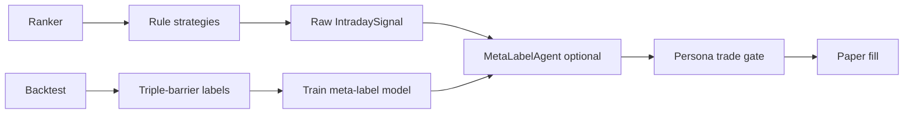

# Meta Layer — Lopez de Prado Cross-Persona Enhancement

The meta layer is **not a trading persona**. It is a shared validation and sizing
framework applied to any persona's rule-generated signals before or during the
trade gate.

**Sources:** Marcos Lopez de Prado, *Advances in Financial Machine Learning*;
Hudson & Thames [mlfinlab](https://github.com/hudson-and-thames/mlfinlab).

Today, calan's trade-gate LLM agent is an informal meta-labeler. This spec
formalizes the pattern for all personas.

---

## 1. Architecture



**Integration points:**

| Component | File | Role |
|-----------|------|------|
| Triple-barrier labels | `src/intraday/simulator.py` | Backtest label generation |
| MetaLabelAgent | `src/intraday/meta.py` (future) | Binary take/skip on raw signals |
| Purged CV | `scripts/intraday_backtest.py` (future) | Parameter tuning without leakage |
| Bet sizing | `src/intraday/sizing.py` (future) | Kelly-scaled position size |

Enabled per persona:

```yaml
intraday:
  meta:
    enabled: false          # default off until trained
    min_meta_confidence: 0.55
    use_llm_fallback: true  # LLM gate when no trained model
```

---

## 2. Triple-barrier labeling

Used in backtests to label rule signals with realistic outcomes (not fixed
horizon return).

### 2.1 Barriers

For each signal at time `t0` with entry price `p0`:

| Barrier | Long | Short |
|---------|------|-------|
| Upper (profit) | `p0 * (1 + pt)` | `p0 * (1 - pt)` |
| Lower (stop) | `p0 * (1 - sl)` | `p0 * (1 + sl)` |
| Vertical (time) | `t0 + max_hold` | `t0 + max_hold` |

Defaults: `pt = target distance / p0`, `sl = stop distance / p0`, `max_hold` =
signal's `force_exit_at - t0`.

### 2.2 Label

Walk forward bar-by-bar from `t0`:

```
if upper touched first:  label = +1  (win)
if lower touched first:  label = -1  (loss)
if vertical reached:     label =  0  (timeout)
```

Touch order: use bar high/low; if both touched same bar, assume stop first
(conservative).

### 2.3 Output

Per signal in backtest results:

```json
{
  "symbol": "RELIANCE",
  "strategy": "opening_range_breakout",
  "side": "BUY",
  "entry_time": "...",
  "label": 1,
  "exit_reason": "upper_barrier",
  "bars_held": 8,
  "return_pct": 0.42
}
```

### 2.4 Implementation sketch

```python
def triple_barrier_label(
    frame: pd.DataFrame,
    entry_time: datetime,
    entry_price: float,
    side: str,
    upper: float,
    lower: float,
    vertical: datetime,
) -> tuple[int, str, int]:
    ...
```

Add to `IntradaySimulator` after each closed trade for training data export.

---

## 3. Meta-labeling

**Question:** Given primary model (rule strategy) fired a signal, should we take it?

This is a **binary classifier** separate from direction prediction.

### 3.1 Features (per signal)

| Feature | Source |
|---------|--------|
| strategy | signal.strategy |
| side | signal.side |
| hour_of_day | entry_time.hour + minute/60 |
| gap_pct | ranker |
| trend_cleanliness | ranker |
| volume_expansion | ranker |
| vwap_distance_pct | ranker |
| gross_rr | (target - entry) / (entry - stop) |
| atr_pct | ranker |
| persona_id | config |
| session_regime | revert analyst output (if available) |
| ofi_z | flux ranker (if available) |
| spread_z | spread analyst (if available) |

### 3.2 Target

`y = 1` if triple-barrier label == +1, else `y = 0` (treat timeout and loss as 0).

Alternative (LdP): `y = 1` only if return > min_threshold after costs.

### 3.3 Model options

1. **LLM gate (current):** Persona trade-gate prompt = meta-labeler with natural
   language features from briefing
2. **Trained classifier (future):** Logistic regression or gradient boosting on
   features above; export from backtest labels
3. **Hybrid:** Classifier primary; LLM fallback when `meta.use_llm_fallback: true`

### 3.4 MetaLabelAgent interface

```python
class MetaLabelAgent:
    def should_take(
        self,
        signal: IntradaySignal,
        ranked: RankedStock,
        frame: pd.DataFrame,
        as_of: datetime,
        context: dict,
    ) -> dict:
        """
        Returns:
          {
            "take": true | false,
            "confidence": 0.0-1.0,
            "method": "model" | "llm" | "rules",
            "rationale": "..."
          }
        """
```

Insert in `IntradayWatchEngine` **after** strategy signal selection, **before**
persona trade gate (or replace gate when meta model is confident enough).

### 3.5 Relationship to persona gates

| Layer | Question |
|-------|----------|
| Rule strategy | What direction/setup? |
| MetaLabelAgent | Should I take this setup? |
| Persona gate | Risk/regime veto on approved setups |

When `meta.enabled: true` and model confidence >= threshold, skip LLM gate for
latency. Persona gate still applies hard risk rules (daily loss, time window).

---

## 4. Purged k-fold cross-validation

Standard k-fold leaks future information when labels overlap in time.

### 4.1 Purging

For each train fold, remove training samples whose label horizon `[t0, vertical]`
overlaps any test sample's `[t0, vertical]`.

### 4.2 Embargo

After each test fold, drop training samples within `embargo_pct * n_samples` bars
( default 1% ) to prevent serial correlation leakage.

### 4.3 Usage

Apply when tuning strategy parameters in `scripts/intraday_backtest.py`:

```yaml
intraday:
  meta:
    cv_folds: 5
    embargo_pct: 0.01
```

Reference: mlfinlab `PurgedKFold`.

---

## 5. Bet sizing (Kelly fraction)

Scale position size by signal quality, not just fixed risk_per_trade_pct.

### 5.1 Formula

From meta-label probability `p` (probability of win) and payoff ratio `b` (avg
win / avg loss from backtest):

```
f* = (p * b - (1 - p)) / b          # full Kelly
f  = f* * kelly_fraction             # default kelly_fraction = 0.25 (quarter Kelly)
position_risk = capital * min(f, max_risk_pct) / 100
```

### 5.2 Caps

```
f = clamp(f, 0, max_risk_per_trade_pct)    # never exceed persona risk cap
f = 0 if meta confidence < min_meta_confidence
```

### 5.3 Integration

Replace fixed `risk_per_trade_pct` sizing in watch/simulator when
`meta.bet_sizing: true`.

---

## 6. Implementation phases

| Phase | Deliverable | Depends on |
|-------|-------------|------------|
| 1 | Triple-barrier in simulator + label export | revert or calan backtest data |
| 2 | MetaLabelAgent stub (rules: take if backtest win rate > 50%) | Phase 1 |
| 3 | Purged CV in backtest script | Phase 1 |
| 4 | Trained classifier from exported labels | Phases 1–3, two personas |
| 4b | Bootstrap train + shadow gate (`scripts/train_meta_model.py`) | Implemented |
| 5 | Kelly bet sizing | Phase 4 |

---

## 7. Config reference

```yaml
intraday:
  meta:
    enabled: false
    log_decisions: false   # set true on apprentice / research personas
    min_meta_confidence: 0.55
    use_llm_fallback: true
    bet_sizing: false
    kelly_fraction: 0.25
    cv_folds: 5
    embargo_pct: 0.01
    labels_path: "data/intraday/meta_labels.csv"
    model_path: "data/intraday/meta_model.pkl"
```

Decisions are stored in PostgreSQL (or SQLite in tests) in **`meta_decisions`** — see §9 below. CSV export remains optional for offline sklearn.

---

## 9. `meta_decisions` table (implemented)

Canonical log for intraday gate take/skip decisions. Schema is applied automatically on first DB connect (`src/journal/db.py`).

| Column | Purpose |
|--------|---------|
| `decision_id` | UUID per gate evaluation |
| `persona_id`, `symbol`, `decision_ts` | Who / what / when |
| `strategy`, `side` | Rule signal context |
| `gate_decision` | `take` or `skip` |
| `gate_method` | `rules`, `llm`, or `model` |
| `model_version`, `model_score` | Lightweight classifier (future) |
| `features` | JSON feature vector for training |
| `rationale`, `news_refs`, `gate_reason` | Human/LLM context |
| `outcome_label`, `meta_label`, `net_pnl`, `exit_reason`, `labeled_at` | Filled post-session |

**Enable logging** on a persona:

```yaml
intraday:
  meta:
    log_decisions: true
```

Gate hook: `IntradayAgent.gate_trade()` → `src/intraday/meta_log.py`.

**Label unlabeled rows:**

```bash
python scripts/label_meta_decisions.py --persona apprentice
```

**Apply schema on VM** after deploy: restart dashboard or run:

```bash
cd /opt/fund && .venv/bin/python -c "from src.journal.db import connect; connect()"
```

### Bootstrap / retrain model

```bash
# From historical candles (bootstrap)
python scripts/train_meta_model.py --persona calan \
  --start 2026-07-28 --end 2026-08-05 --cache-only --backtest-only

# After live labels accumulate (journal + backtest)
python scripts/train_meta_model.py --persona calan --cache-only
```

Artifacts: `data/intraday/meta_model_{persona}.pkl`

Calan / calan_us: `meta.enabled: true`, `shadow: true` (scores + logs, does not veto yet).
Set `shadow: false` to let the model veto takes below `min_meta_confidence`.

---

## 8. References

- Lopez de Prado, Ch. 3 (triple barrier), Ch. 4 (meta-labeling), Ch. 7 (purged CV), Ch. 10 (bet sizing)
- mlfinlab: `labeling`, `cross_validation`, `bet_sizing` modules
- Current LLM gate: [`src/intraday/prompts.py`](../../src/intraday/prompts.py) TRADE_GATE_SYSTEM_PROMPT
