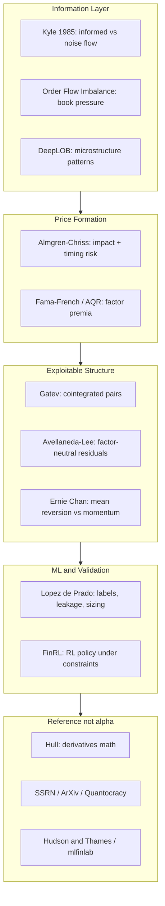

# Intraday Personas from Quant First Principles

Design specification for five intraday trading personas grounded in market
microstructure, relative value, execution theory, and ML validation literature.
See linked persona specs for implementation-ready formulas.

**Status:** All five personas implemented (strategies, rankers, agents). Enable via
`personas.<id>.enabled: true` in settings.yaml.

| Persona | Status | Spec |
|---------|--------|------|
| calan | Live | — (baseline) |
| revert | Implemented | [personas/revert.md](personas/revert.md) |
| flux | Implemented | [personas/flux.md](personas/flux.md) |
| spread | Implemented | [personas/spread.md](personas/spread.md) |
| slice | Implemented | §5 below |
| meta (cross-cutting) | Designed | [meta_layer.md](meta_layer.md) |

---

## 1. What exists today

[`calan`](../../config/settings.yaml) is the only live persona: momentum/breakout
intraday on Nifty 50, ORB + VWAP strategies, two LLM agents (catalyst scan +
trade gate), paper MIS, flat by 15:15.

Personas are YAML config overlays merged by [`get_persona_config()`](../../src/config.py).
Strategies register via [`STRATEGY_REGISTRY`](../../src/intraday/strategies.py).
Prompts route by `config.persona_id` via [`PERSONA_PROMPTS`](../../src/intraday/prompts.py).

Run: `python run_daily.py watch --persona <id>`

---

## 2. First-principles stack

Market edge decomposes into layers: **information → price formation → exploitable
structure → execution → validation**.



### Layer 1 — Information and flow (Kyle, OFI, DeepLOB)

**Principle:** Price moves when informed traders consume liquidity (Kyle's lambda).
Order flow imbalance at the touch predicts short-horizon direction (Cont et al.).
DeepLOB shows local book shape is predictive — but requires tick/LOB data.

**Intraday:** Momentum (calan) bets *with* informed flow. Mean reversion and
spreads bet *against* temporary dislocations. Scalping needs toxicity filters.

**NSE constraint:** Angel One provides OHLCV candles, not full LOB. OFI personas
use candle proxies until WebSocket tick data is available.

### Layer 2 — Execution (Almgren & Chriss)

**Principle:** Alpha and execution are separable. Implementation shortfall =
permanent impact + timing risk. VWAP/TWAP are schedules, not alpha.

**Intraday:** calan uses VWAP as trend filter. slice persona schedules child
orders to minimize shortfall.

### Layer 3 — Relative value (Gatev, Avellaneda-Lee, Chan)

**Principle:** Some price relationships are stationary; deviations mean-revert.
Momentum and mean reversion are regime-dependent.

**Intraday:** Intraday pairs and VWAP fades on NSE; hold minutes to hours, flat
by 15:15.

### Layer 4 — Factors (Fama-French, AQR)

**Principle:** Most return is systematic exposure. Alpha is the residual after
neutralizing factors.

**Intraday:** Index-beta awareness matters. Personas declare beta posture:
beta-seeking (calan), beta-neutral (spread), beta-aware (revert, flux).

### Layer 5 — ML discipline (Lopez de Prado, FinRL)

**Principle:** Standard ML fails due to label leakage and overlapping samples.
Meta-labeling asks "given this rule fired, should I take it?"

**Intraday:** meta layer is cross-persona — see [meta_layer.md](meta_layer.md).
calan's trade-gate LLM is an informal meta-labeler today.

### Layer 6 — Out of scope

Hull (derivatives), SSRN/ArXiv feeds, and research aggregators inform the reading
queue but are not runtime components for cash intraday personas.

---

## 3. Persona portfolio

Five personas, five orthogonal hypotheses:

| Persona | Hypothesis | Sources | vs calan |
|---------|-----------|---------|----------|
| **calan** | Informed flow + catalyst → continuation | Kyle, Almgren, AQR | — |
| **revert** | Dislocations revert within session | Gatev, Avellaneda-Lee, Chan | Opposite regime |
| **flux** | Signed flow imbalance → next-bar direction | Kyle, OFI, DeepLOB proxy | Flow not catalyst |
| **spread** | Cointegrated spreads revert intraday | Gatev, Avellaneda-Lee | Two-leg, neutral |
| **slice** | Minimize shortfall on scheduled entries | Almgren-Chriss | No directional bet |

**Shared infrastructure:** [`IntradayWatchEngine`](../../src/intraday/watch.py),
[`IntradayRanker`](../../src/intraday/ranking.py), paper fills, force-exit 15:15,
state at `data/intraday/{persona_id}_*`.

---

## 4. Persona summaries

### calan (live)

Philosophy: *Trade with the informed.*

- Strategies: `opening_range_breakout`, `vwap_pullback`
- Agents: catalyst scan (Stocks in Play), trade gate (risk officer)
- No design changes; reference architecture

### revert

Philosophy: *Fade extremes, not trends.*

Full spec: [personas/revert.md](personas/revert.md)

- Strategies: `vwap_fade`, `opening_gap_fade`, `range_revert`
- Agents: regime analyst, reversion gate
- Config stub: `personas.revert` in settings.yaml (`enabled: false`)

### flux

Philosophy: *Follow signed pressure.*

Full spec: [personas/flux.md](personas/flux.md)

- Strategies: `ofi_momentum`, `ofi_exhaustion`
- Agents: flow analyst, toxicity gate
- Requires ONE_MINUTE candles and candle pool throughput

### spread

Philosophy: *Trade the spread, not the stock.*

Full spec: [personas/spread.md](personas/spread.md)

- Strategies: `pair_zscore`
- Agents: spread analyst, convergence gate
- Requires two-leg execution model (largest infrastructure lift)

### slice

Philosophy: *Don't chase — schedule.*

- Strategies: `twap_slice`, `vwap_schedule`
- Agent: schedule monitor only (no veto gate)
- Parent orders from config; could merge into main fund executor later

```yaml
parent_orders:
  - symbol: TCS
    side: BUY
    qty: 100
    schedule: twap
    start: "10:00"
    end: "14:00"
```

---

## 5. Research reading map

| # | Resource | Persona(s) | Extract |
|---|----------|------------|---------|
| 1 | Kyle 1985 | calan, flux | Informed flow, toxicity |
| 2 | Almgren-Chriss | calan, slice | VWAP/TWAP, shortfall |
| 3 | Gatev pairs | spread, revert | Z-score, cointegration |
| 4 | Avellaneda-Lee | spread | Factor-neutral residuals |
| 5 | DeepLOB | flux | Feature inspiration (defer) |
| 6 | OFI paper | flux | Core signal; candle proxy |
| 7 | FinRL | all (future) | RL for gate/sizing |
| 8 | Lopez de Prado | meta | Triple barrier, meta-label |
| 9 | Ernie Chan | revert, spread | Regime, half-life |
| 10 | Hull | — | Out of scope |
| 11 | Fama-French | spread | Beta-neutral pairs |
| 12 | AQR | calan | Momentum quality |
| 13–17 | Research feeds | all | Idea pipeline |
| 18 | Hudson-Thames | meta | mlfinlab reference |

---

## 6. Prompt routing architecture

System prompts are no longer module-level constants only. [`prompts.py`](../../src/intraday/prompts.py)
defines `PERSONA_PROMPTS` keyed by persona ID:

```python
PERSONA_PROMPTS = {
    "calan":  {"catalyst": ..., "gate": ..., ...},
    "revert": {"catalyst": ..., "gate": ..., ...},
    "flux":   {"catalyst": ..., "gate": ..., ...},
    "spread": {"catalyst": ..., "gate": ..., ...},
    "slice":  {"catalyst": ..., "gate": None, ...},  # monitor only
}
```

[`IntradayAgent`](../../src/intraday/agent.py) resolves prompts and validators via
`get_persona_prompt_bundle(config.persona_id)`. Briefing builders in
[`briefing.py`](../../src/intraday/briefing.py) dispatch on persona ID.

Unknown persona IDs fall back to calan prompts.

---

## 7. Cross-cutting meta layer

See [meta_layer.md](meta_layer.md) for triple-barrier labels, meta-labeling,
purged k-fold CV, and Kelly bet sizing integration points.

---

## 8. Build order

1. **revert** — smallest delta; opposite ranker; proves multi-persona routing
2. **flux** — 1-min polling + OFI proxy; tests candle pool
3. **spread** — two-leg state; offline cointegration pre-test
4. **slice** — optional; may merge into fund executor
5. **meta** — after two personas have backtest data

---

## 9. Infrastructure gaps

| Gap | Personas affected | Resolution |
|-----|-------------------|------------|
| Persona-specific rankers | revert, flux, spread | Extend `IntradayRanker` or subclass |
| ONE_MINUTE candle throughput | flux | `AngelOneCandlePool` |
| Two-leg fills + pair P&L | spread | New models in `state.py` |
| Tick/LOB feed | flux (upgrade) | Angel One WebSocket |
| Strategy implementations | revert, flux, spread, slice | `strategies.py` per build order |
| F&O / derivatives | — | Future; Hull out of scope |
