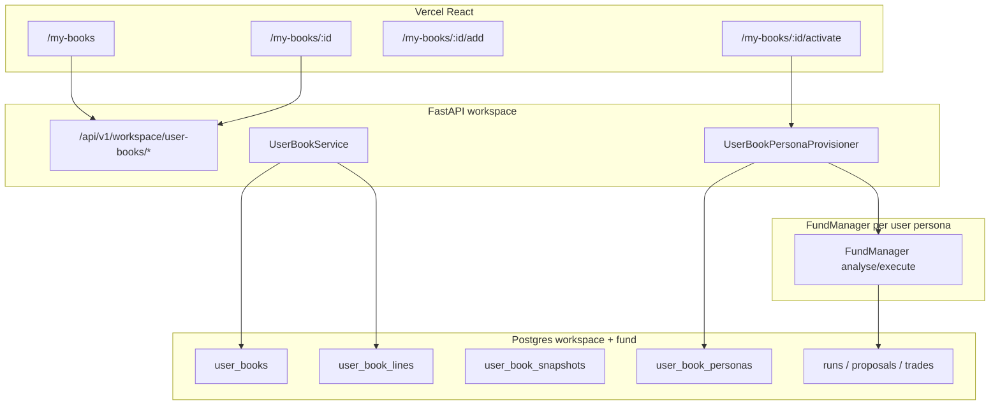

# User Watchlist & Custom Paper Persona — Design

Branch: `watchlist`  
Status: design (Figma → API → backend → React)

## Problem

Users want to:

1. **Pick their own stocks** (not only AI-generated model portfolios or fund personas).
2. **Allocate capital** per name (₹ amount or weight).
3. **Track performance** privately (paper, delayed EOD).
4. **Optionally activate** the same basket as a **live paper persona** that runs the normal swing cycle (`analyse` → auto-approve → `execute`) like `balanced`, but constrained to their picks.

This must coexist with:

| Existing concept | Scope | Do not confuse with |
|------------------|-------|---------------------|
| Fund personas (`balanced`, `calan`, …) | `persona_id`, yaml + journal | User watchlist |
| Intraday `watchlist` | Session catalyst names in `PaperState` | Persistent user book |
| `workspace_portfolios` | AI quant screen from profile | User-curated picks |
| `dashboard_snapshots` | Global fund EOD publish | Per-user data |

**Product name (UI):** **My Book** or **Custom Portfolio**  
**Code/API namespace:** `user_books` (avoids collision with intraday `watchlist`)

---

## Design principles

1. **Track first, trade later** — Phase 1 is read-only tracking; activation is explicit opt-in.
2. **One owner key** — everything hangs off `workspace_users.id` (Google auth).
3. **Paper only until admin gate** — activation creates `DRY_RUN=true`, `auto_approve=true` paper persona; no live broker.
4. **Fixed universe when live** — activated persona only researches/trades symbols in the book (+ cash), not full Nifty 500.
5. **Amount in, weight out** — User enters ₹; system stores normalized weights + snapshot entry prices.

---

## User journeys

### Journey A — Build & track (Phase 1)

```
Sign in → My Books → Create book (name, market IN/US)
  → Add stock (search) → Enter ₹ amount OR % weight
  → Overview: total value, day change, since-added return
  → Holdings table: symbol, allocation, P&L
```

### Journey B — Activate paper persona (Phase 2)

```
Book detail → "Run as paper fund" (CTA)
  → Review: symbols, weights, starting capital, strategy template (balanced-like)
  → Confirm → status: provisioning → active
  → Link to read-only persona dashboard (existing /personas/:id)
  → Cron picks up user persona on next long_cycle (or dedicated user_book_cycle)
```

### Journey C — Edit while tracking

- Add/remove symbols recalculates weights (optional: lock weights manually).
- **While paper persona is active:** edits create a *draft* revision; rebalance only after user confirms (avoid silent drift vs running book).

---

## Architecture



---

## Data model

All tables are **workspace-scoped** (never mixed with another user's rows).

### `user_books`

| Column | Type | Notes |
|--------|------|-------|
| `id` | TEXT PK | uuid |
| `user_id` | INT FK → workspace_users | owner |
| `name` | TEXT | e.g. "Dividend picks" |
| `market_id` | TEXT | `india_equity` / `us_equity` |
| `currency` | TEXT | INR / USD |
| `status` | TEXT | `draft` / `tracking` / `active_paper` / `archived` |
| `starting_capital` | REAL | user-entered book size (INR/USD) |
| `allocation_mode` | TEXT | `amount` (₹ per line) or `weight` (%) |
| `created_at`, `updated_at` | TEXT | ISO8601 |

Unique: `(user_id, lower(name))` where status != archived

### `user_book_lines`

| Column | Type | Notes |
|--------|------|-------|
| `id` | TEXT PK | |
| `book_id` | TEXT FK | |
| `user_id` | INT FK | denormalized |
| `symbol` | TEXT | |
| `target_amount` | REAL NULL | ₹/$ user intent |
| `weight_pct` | REAL NULL | computed or manual |
| `entry_price` | REAL | EOD at add |
| `entry_date` | TEXT | |
| `notes` | TEXT NULL | |
| `added_at` | TEXT | |
| `removed_at` | TEXT NULL | soft delete |

### `user_book_snapshots`

Daily EOD valuation for tracking UI (same pattern as prior tracked-portfolio design).

PK: `(book_id, snapshot_date)`

### `user_book_personas` (Phase 2 — link book → fund)

| Column | Type | Notes |
|--------|------|-------|
| `id` | TEXT PK | |
| `book_id` | TEXT FK UNIQUE | one active persona per book |
| `user_id` | INT FK | |
| `persona_id` | TEXT | e.g. `userbook_<uuid>` |
| `template_persona_id` | TEXT | `balanced` — copied policy defaults |
| `status` | TEXT | `requested` / `provisioning` / `active` / `paused` / `failed` |
| `frozen_allocation` | TEXT JSON | weights at activation |
| `provisioned_at` | TEXT NULL | |
| `created_at` | TEXT | |

Fund journal rows use **`persona_id`** as today; user books do not duplicate trades.

### Persona runtime config (Phase 2)

Prefer **DB-backed persona overlay** over committing yaml per user:

```json
{
  "persona_id": "userbook_abc123",
  "owner_user_id": 42,
  "source_book_id": "book_xyz",
  "market_id": "india_equity",
  "capital_inr": 500000,
  "universe_mode": "fixed",
  "symbols": ["RELIANCE", "TCS", "INFY"],
  "target_weights": {"RELIANCE": 40, "TCS": 35, "INFY": 25},
  "strategy_template": "balanced",
  "execution": {"auto_approve": true, "dry_run": true}
}
```

Loaded by extending `get_persona_config()` to merge DB overlay when `persona_id` starts with `userbook_`.

---

## API sketch

Base: `/api/v1/workspace/user-books`  
Auth: `workspace_auth.identity` (member); activation may require billing entitlement (`WorkspaceBilling.require_access`).

| Method | Path | Purpose |
|--------|------|---------|
| GET | `/` | List user's books |
| POST | `/` | Create `{ name, market_id, starting_capital }` |
| GET | `/{id}` | Detail + latest marks |
| PATCH | `/{id}` | Rename, capital, allocation mode |
| DELETE | `/{id}` | Archive |
| GET | `/{id}/lines` | Holdings |
| POST | `/{id}/lines` | Add `{ symbol, target_amount? \| weight_pct? }` |
| PATCH | `/{id}/lines/{symbol}` | Update allocation |
| DELETE | `/{id}/lines/{symbol}` | Remove |
| GET | `/{id}/performance` | Snapshot series |
| POST | `/{id}/activate` | Phase 2: provision paper persona |
| GET | `/{id}/persona` | Link + status of activated book |

Admin (optional): queue for first activation approval — same pattern as tracked-portfolio deploy.

---

## FE routes (Vercel app)

| Route | Screen |
|-------|--------|
| `/my-books` | List cards + "Create book" |
| `/my-books/new` | Name, market, starting capital |
| `/my-books/:id` | Overview chart, total return, CTA activate |
| `/my-books/:id/holdings` | Table: symbol, ₹ allocated, weight %, return |
| `/my-books/:id/add` | Symbol search + amount input |
| `/my-books/:id/activate` | Confirm template + capital + weights |
| `/my-books/:id/persona` | Status + deep link to `/personas/:personaId` |

**Nav:** "My Books" separate from "Fund personas" and "Suggested model portfolio".

---

## Figma — how to start

Do **Figma before backend** so amount/weight UX is settled once.

### Step 1 — Flow map (1 frame)

Draw 5 screens as boxes with arrows:

1. My Books (empty + populated states)
2. Create book
3. Add stock (search + ₹ input)
4. Book overview (holdings + performance)
5. Activate paper fund (confirmation modal)

### Step 2 — Key frames to design (MVP)

| # | Frame | Must show |
|---|-------|-----------|
| 1 | Empty state | CTA "Create your first book" |
| 2 | Create book | Name, India/US toggle, starting capital ₹ |
| 3 | Add holding | Autocomplete symbol, "Invest ₹" field, live weight preview |
| 4 | Overview | Total value, day %, list of lines with since-added % |
| 5 | Activate modal | "Run as paper fund", template dropdown (Balanced), disclaimer |
| 6 | Active state | Badge "Paper fund live" + link to persona view |

Use existing Nivelo dark theme (`#112820`, research dashboard hero) for consistency.

### Step 3 — Component checklist

Reuse from main app where possible:

- Symbol search combobox
- Performance mini chart
- Disclaimer footer ("Paper tracker. Not investment advice.")
- Google avatar / nav shell

New components:

- **Allocation row** — symbol, ₹, weight %, sparkline
- **Capital slider** — optional adjust starting capital
- **Activate CTA** — primary, destructive-safe copy

### Step 4 — Prototype interactions

- Add stock → weight bar animates to new total (must sum ≤ 100% or show "unallocated cash")
- Activate → loading → success with persona link

### Step 5 — Handoff

Export for eng:

- Frame names = route names (`/my-books/:id/add`)
- Redlines for API fields next to inputs (`target_amount`, `starting_capital`)
- One **API contract** page listing endpoints (copy from this doc)

**Figma file suggestion:** duplicate the existing Nivelo research file → page **"My Books MVP"** so tokens match.

---

## Implementation phases

| Phase | Scope | Ship |
|-------|--------|------|
| **0** | Figma flows + API contract review | Design sign-off |
| **1** | DB + CRUD + EOD snapshots + FE track-only | Users build & track |
| **2** | `user_book_personas` + DB persona overlay + cron | Paper fund runs |
| **3** | Rebalance drafts, billing gate, admin queue | Production hardening |

---

## Open decisions

1. **Max books per user** — suggest 5 for MVP.
2. **Max lines per book** — suggest 25 (matches fund `target_positions`).
3. **Activation approval** — auto for owner on trial, admin queue for production?
4. **US books** — same flow with `$` and Alpaca paper when market is `us_equity`.

---

## Relation to prior tracked-portfolio plan

Same ownership model and snapshot math; renamed to **`user_books`** for product clarity. Phase 2 persona provisioning replaces generic "deploy" with **`UserBookPersonaProvisioner`** tied to `FundManager` + fixed universe.
